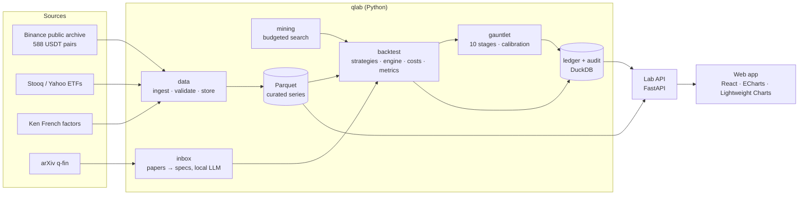

# quant-lab

[](https://github.com/discoenmarte/quant-lab/actions/workflows/ci.yml)

An evidence-first quant research lab that runs on one machine. It builds a data lake from free sources,
backtests single instruments and multi-asset portfolios with realistic costs, puts every candidate through a
10-stage validation gauntlet calibrated on synthetic markets, and shows all of it in a web interface. Every
backtest is recorded in a trial ledger, so the statistics stay honest about how many things were tried.

**Calibrated:** with 20 years of daily data the gauntlet catches an edge Sharpe of 1.0 95% of the time and 0.5
about half the time, and lets noise through 1.4% of the time ([decision 0004](docs/decisions/0004-gauntlet-design.md)).
On synthetic crypto cross-sections of 5.6 years it lets noise through 0.16% of the time and catches a momentum edge
of 1.0 85% of the time ([decision 0006](docs/decisions/0006-crypto-cross-section.md)).

> Research and paper trading only. Nothing in this repository places real-money orders.

## Quick start

```bash
make setup     # Python env (uv) + web dependencies (npm)
make test      # tests
make serve     # build the web app and serve everything on http://127.0.0.1:8765
```

Development with hot reload: `make dev-api` in one terminal, `make dev-web` in another (http://127.0.0.1:5173).

Forward paper book: add gauntlet cards on the Trading Desk (or `uv run qlab paper add <card>`), then run
`make paper-nightly` after each US close, or `make paper-launchd` to print a launchd job that does it for you.

## Architecture

Simple, strong, and able to grow. One Python package, one database file, one API, one static web app. Each
layer has a narrow contract, data flows one way, and the scale-up path is written down before it's needed.



### Layers and their contracts

| Layer | Package | Contract |
|---|---|---|
| Data | `qlab.data` | Each series is a Parquet file `curated/<source>/<symbol>/<interval>.parquet` with columns `ts` (UTC), `open, high, low, close, volume` (+ `adj_close` or `quote_volume` when the source has it). Ingestion is idempotent and verifies checksums when the source publishes them. Quality issues go to the `quality_issues` table. The crypto cross-section's manifest records which Binance pairs were kept and why the others weren't. |
| Backtest | `qlab.backtest` | A strategy is a pure function `positions = f(bars, **params)` that may only use data up to each bar. The engine applies positions from the next bar, charges costs on every change, and returns daily returns, positions and trades. |
| Portfolio | `qlab.portfolio` | A panel aligns several instruments on one calendar: static panels on the dates every member shares, dynamic panels (the crypto cross-section) with an availability mask and point-in-time membership. A portfolio strategy is a pure function `weights = f(panel, **params)`; the engine fills at the next open with per-instrument costs (drifting positions on dynamic panels) and judges against equal weight through the same engine. |
| Gauntlet | `qlab.gauntlet` | Judges a *subject* (a single-instrument rule or a portfolio rule) over its family's parameter grid, on research data before the fixed lockbox date, on the edge beyond buy-and-hold. Returns a report card: ten stages with value, threshold, pass/fail and chart data. Thresholds are versioned and calibrated on synthetic markets. |
| Ledger | `qlab.ledger`, `qlab.audit` | Append-only. Every backtest is a trial on a research question; every action is an audit event. |
| Inbox | `qlab.inbox` | Papers become structured `StrategySpec` records through an LLM provider interface (local Ollama by default). |
| Mining | `qlab.mining` | Budgeted search over a strategy grammar. Every candidate is a ledger trial, and the significance bar rises with N. |
| API | `qlab.api` | Thin HTTP layer, no business logic. The web app, the CLI and (later) a Telegram bot all use it. |
| Web | `web/` | Static React app that reads the API only. Every page belongs to a milestone. |

### Principles

- **Honesty is structural.** Look-ahead is prevented by the strategy contract and tested by changing future
  data. The trial count N sits next to every Sharpe ratio. The lockbox holdout is used once.
- **Data flows one way:** sources → raw → curated → backtests → gauntlet → registry → paper. No layer reads
  from the layer above it.
- **Time is UTC** in storage. The UI shows exchange time next to it.
- **Reproducible.** Seeds are fixed for simulations, inputs are fingerprinted, and dependencies are locked
  (`uv.lock`, `package-lock.json`).
- **Safe by default.** The server binds to 127.0.0.1, secrets stay in `.env` (ignored), and no code path can
  send a real order. From M7 on, reducing risk is one click and increasing it needs a reason and a delay.

### Scaling path (taken only when a limit is actually hit)

| Limit | Step |
|---|---|
| Long jobs block the API | Worker process + job queue |
| Concurrent writers | Postgres / TimescaleDB instead of the DuckDB file |
| Mining too slow on 15 cores | Process pool, then Ray; measured hot loops in Rust ([decision 0001](docs/decisions/0001-python-first-rust-where-measured.md)) |
| Many scheduled jobs | Dagster ([decision 0003](docs/decisions/0003-orchestration-and-ui-stack.md)) |
| Years of minute bars | Parquet partitioned by year |

## Milestones

| | Milestone | Delivers | Status |
|---|---|---|---|
| M0 | Foundations | Package, ledger, audit log, Lab API, web shell, CI | done |
| M1 | Data lake | Free sources (ETFs, BTC/ETH, factors), quality checks, Data Health page | done |
| M2 | Backtest engine | Strategy library, cost model, metrics, Backtest Studio | done |
| M3 | Validation gauntlet | 10 stages on edge returns, fixed lockbox, calibration (three studies), Gauntlet Console, Ledger page | done |
| M3b | Portfolio lab | Multi-asset panels, weights engine, six diversified strategies, portfolio gauntlet and calibration, pre-registered batches | done |
| M3c | Breadth | Survivorship-free crypto cross-section (588 Binance USDT pairs, delisted ones included), point-in-time universes, drifting positions, four published crypto factor rules, a cross-sectional null, calibration study E and pre-registered verdicts ([decision 0006](docs/decisions/0006-crypto-cross-section.md)) | done |
| M4 | Research inbox | arXiv feed, local-LLM triage and specs, replication checks | planned |
| M5 | Strategy mining | Grammar search, genetic programming, rising significance bar | planned |
| M6 | Registry and alerts | Strategy board, portfolio, alert rules | planned |
| M7a | Forward paper book | Daily targets recorded before the next bar exists, scored with the backtest engines against frozen research bands, a CUSUM decay alarm, a nightly job, Trading Desk ([decision 0007](docs/decisions/0007-forward-paper-book.md)) | done |
| M7b | Broker paper trading | Broker paper accounts, real fills and reconciliation, kill switch | planned |
| M8 | Go-live gate | Evidence checklist, limits outside any model | planned |
| M9 | Intraday mode | Validated intraday library, morning selector, replay | planned |

The full plan, with each milestone's screens, costs and the research it rests on, is in
[ROADMAP.md](ROADMAP.md). What to build next, what it costs and what it can earn: [docs/SCALING.md](docs/SCALING.md). Implementation state and next steps are in [docs/HANDOFF.md](docs/HANDOFF.md).

## Repository layout

```
src/qlab/          Python package (data, backtest, portfolio, gauntlet, paper, api, ledger, lockbox, audit)
tests/             pytest suite; each test gets its own data folder
web/               React app (Vite + TypeScript)
docs/STYLE.md      docstring and commit conventions
docs/decisions/    architecture decision records
docs/HANDOFF.md    implementation status and how to continue
ops/launchd/       template for the nightly paper job (rendered and printed, never installed)
data/              local data lake and database (not committed)
```

## Decisions

1. [Python first, Rust where a measurement says so](docs/decisions/0001-python-first-rust-where-measured.md)
2. [Reverse-engineering is an audit tool, not an alpha source](docs/decisions/0002-rea-scope.md)
3. [Keep the stack small](docs/decisions/0003-orchestration-and-ui-stack.md)
4. [Gauntlet design: edge returns, a fixed lockbox, honest N, thresholds from calibration](docs/decisions/0004-gauntlet-design.md)
5. [Portfolios and forward evidence before the paper inbox and mining](docs/decisions/0005-portfolios-and-forward-evidence-first.md)

6. [A survivorship-free crypto cross-section: dynamic panels, drifting positions and a cross-sectional null](docs/decisions/0006-crypto-cross-section.md)
7. [The forward paper book: decisions before outcomes, frozen expectations, honest power](docs/decisions/0007-forward-paper-book.md)
